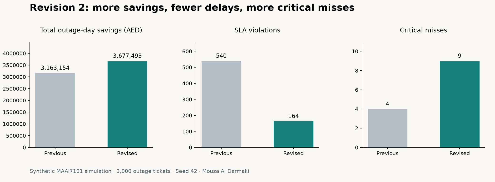

# Cost-aware Ticket Triage

**Mouza Al Darmaki · MBZUAI · MAAI7101 · Classifiers in Production**

A classifier becomes useful when its predictions lead to better decisions. This project routes simulated telecom support tickets to an automated script, a generalist, or a specialist, while accounting for labor prices, customer impact, queue delays, and imperfect expert advice.



## Measured outcome

On the supplied outage-day simulation, the policy saved **AED 1,225,831 per 1,000 tickets**, compared with **AED 715,728** for the instructor's starter policy. Across the full 3,000-ticket day, that is **AED 3,677,493 in simulated total savings** relative to sending every ticket to a generalist.

Critical tickets that never reached a specialist fell from **75 to 9**. Five regional network critical tickets missed the specialist desk.

These are different units: **AED 1.23 million per 1,000** and **AED 3.68 million total** describe the same run. They are simulated cost savings, not revenue or measured real-world savings.

## What I worked on

The five policy entry points implement:

- **Weighted model training:** histogram gradient boosting with the supplied sample weights.
- **Cost-aware routing:** choose the desk with minimum expected cost using current prices and queues.
- **Expert escalation:** pay for a label only when its expected decision value exceeds its fee; account for the expert being wrong.
- **Label selection:** spend the 400-label budget on cost-weighted uncertainty, with coverage across customer segments.
- **Outage safeguards:** adjust regional critical risk and prevent risky mass automation, while preserving cost-aware specialist allocation.

I completed this course exercise with AI assistance for implementation, verification, environment troubleshooting, and documentation. The measured results and policy are inspectable here. I do not claim to have authored the instructor's simulator, assignment, or datasets.

## A tradeoff worth reporting

Compared with the previously published policy, outage-day total savings increased from **AED 3,163,154 to AED 3,677,493**, an improvement of **AED 514,339**. SLA violations fell from **540 to 164**, but critical misses increased from **4 to 9** (regional network misses: **0 to 5**). This is a cost improvement with a safety tradeoff, not a win on every metric. The revised policy remains a single global HistGradientBoosting model; a three-model alternative was tested and saved less on the official day and two validation days. See [what changed](CHANGELOG.md).

The official evaluation day had already been observed. Separate validation seeds 903/904 compared candidates; a subsequent independent seed 905 check showed savings increasing from AED 2,884,403 to AED 3,381,216, with critical misses increasing 3 to 13 and SLA violations falling 525 to 175. These checks use the same synthetic generator and do not establish real-world performance.

## Explore the work

- [Policy implementation](policy.py)
- [Measured metrics and units](metrics.json)
- [Design decisions and limitations](APPROACH.md)
- [Reproduction runner](reproduce.py)
- [Attribution and materials](ATTRIBUTION.md)

## Reproduce the routing experiment

Obtain the original **MAAI7101 Lab 9: Classifiers in Production** package through the course. This repository intentionally does not redistribute its PDFs, datasets, notebooks, or simulator. It requires that package and is not a standalone application.

In the instructor lab folder, use its declared Python environment:

```sh
uv sync --frozen --python 3.13
```

Then run this repository's verifier with the lab environment (replace both example paths):

```sh
/path/to/09_lab_classifiers_in_prod/.venv/bin/python \
  /path/to/cost-aware-ticket-triage/reproduce.py \
  --lab /path/to/09_lab_classifiers_in_prod
```

The runner uses the instructor's original scoring functions, verifies the policy contract, and writes a new metrics JSON. The supplied reference results used **Python 3.13.15**, **scikit-learn 1.9.1**, and **seed 42**. Library and platform differences can affect timing or numerical results.

For the course dashboard, copy `policy.py` to `student.py` **in a separate working copy** of the instructor lab, then run `uv run lab.py` and open `http://127.0.0.1:8000`. The policy retains the five entry points expected by the lab.

On macOS, XGBoost and LightGBM may separately need an OpenMP runtime for the instructor's demonstration notebooks. This routing policy itself uses scikit-learn histogram boosting. The lab README mentions Python 3.14, but its project metadata and lab slides specify Python 3.13; the reference run follows the project metadata.

## Scope

This is Sara's **MAAI7101** course work. It is separate from Artem's **MAAI7102** work. The repository demonstrates the ticket-routing exercise; it makes no claim that every optional AutoML notebook experiment was completed. No real customer data, personal Hub files, or LMS submission credentials are included.
